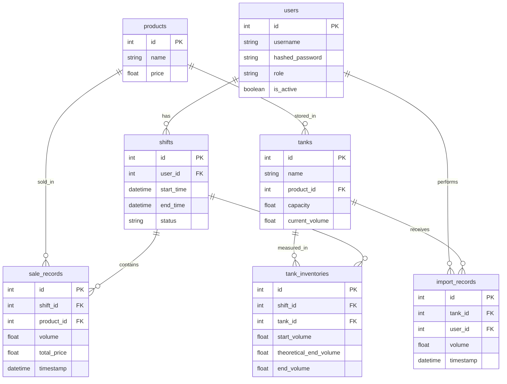

# BÁO CÁO YÊU CẦU BÀI TOÁN

## 1. Tên đề tài
**Hệ thống quản lý trạm xăng dầu tích hợp AI & Camera thông minh** (AI-Integrated Gas Station Management System with ANPR & Safety Camera)

## 2. Mục tiêu dự án
Xây dựng một hệ thống phần mềm toàn diện phục vụ cho công tác quản lý trạm xăng dầu. Điểm nổi bật của hệ thống là việc tích hợp Trí tuệ nhân tạo (AI - Google Gemini) nhằm mục đích tự động hóa quá trình tổng hợp báo cáo sau mỗi ca làm việc, phân tích dữ liệu tồn kho và đặc biệt là phát hiện các sự cố, bất thường (ví dụ: thất thoát nhiên liệu) một cách thông minh và nhanh chóng. Ngoài ra, hệ thống tích hợp thêm module **Camera thông minh (ANPR/LPR)** để nhận diện biển số xe và giám sát an toàn khu vực bơm xăng.

## 3. Các yêu cầu chức năng (Functional Requirements)

Hệ thống cần đáp ứng các chức năng cốt lõi sau:

### 3.1. Quản lý bồn chứa (Tanks Management)
- Theo dõi trạng thái, dung tích hiện tại của các bồn chứa nhiên liệu.
- Đảm bảo logic nghiệp vụ: Không thể bán vượt quá số lượng nhiên liệu đang có trong bồn.

### 3.2. Quản lý ca làm việc (Shifts Management)
- Mở ca làm việc mới (ghi nhận nhân viên trực, thời gian bắt đầu, lượng nhiên liệu đầu ca).
- Đóng ca làm việc (ghi nhận thời gian kết thúc, lượng nhiên liệu cuối ca).

### 3.3. Quản lý giao dịch bán hàng (Sales)
- Ghi nhận các giao dịch bán nhiên liệu trong từng ca làm việc.
- Liên kết số lượng bán ra với bồn chứa tương ứng để cập nhật tồn kho.

### 3.4. Quản lý nhập hàng (Imports)
- Ghi nhận lượng nhiên liệu nhập vào bồn chứa trong quá trình diễn ra ca làm việc.

### 3.5. Tích hợp Trí tuệ nhân tạo (AI Integration)
- Sử dụng mô hình Google Gemini 1.5 Pro.
- Chức năng tự động tổng hợp thông tin ca làm việc (bao gồm: lượng nhiên liệu đầu ca, lượng nhiên liệu cuối ca, tổng nhập, tổng bán).
- AI thực hiện phân tích đối chiếu dữ liệu để sinh ra báo cáo dưới cấu trúc JSON bao gồm:
  - **Tóm tắt (Summary):** Đánh giá chung về ca làm việc.
  - **Phân tích tồn kho (Inventory Analysis):** Đối chiếu chênh lệch giữa thực tế và sổ sách.
  - **Phát hiện bất thường (Abnormalities):** Cảnh báo nếu phát hiện thiếu hụt, hao hụt nhiên liệu bất thường so với mức cho phép.

### 3.6. Quản lý người dùng và Phân quyền (Authentication & Authorization)
- Đăng nhập, đăng xuất sử dụng xác thực JWT Token.
- Phân quyền theo vai trò (Role-based access control - RBAC). 
- Ví dụ: Chỉ có Quản lý (Manager) hoặc Kế toán (Accountant) mới có quyền truy cập và xuất các báo cáo phân tích từ AI.

## 4. Các yêu cầu phi chức năng (Non-Functional Requirements)

- **Kiến trúc hệ thống:** 
  - Backend: RESTful API phát triển bằng Python (FastAPI).
  - Frontend: Giao diện người dùng phát triển bằng React (Vite) kết hợp Tailwind CSS để mang lại trải nghiệm (UI/UX) hiện đại, cao cấp.
- **Cơ sở dữ liệu:** Hệ quản trị cơ sở dữ liệu quan hệ (SQLite sử dụng ORM SQLAlchemy) phục vụ quá trình phát triển và kiểm thử nội bộ. Đầy đủ các thiết kế ERD (Entities, Primary/Foreign keys, Relationships).
- **Hiệu năng:** Phản hồi mượt mà, thời gian trễ trong việc gọi API tới AI model nằm trong mức chấp nhận được.
- **Bảo mật:** Dữ liệu mật khẩu cần được mã hóa (bcrypt), các endpoint quan trọng phải được bảo vệ bởi Token.

---

## 3.7. Module Nhận diện biển số xe & Camera an toàn (ANPR / Safety Camera)

> Đây là nhiệm vụ mở rộng cao cấp, ứng dụng **Học sâu (Deep Learning)** để giải quyết bài toán thị giác máy tính (Computer Vision) trong môi trường trạm xăng thực tế.

### 3.7.1. Tổng quan về bài toán và kiến trúc mạng học sâu

Hệ thống ứng dụng AI chủ yếu ở hai bài toán: **xử lý ảnh biển số xe** và **hỗ trợ khai thác dữ liệu an toàn**. Với ANPR, ảnh hoặc luồng video từ camera được đưa qua bước trích xuất khung hình bằng OpenCV. **YOLOv8** đóng vai trò phát hiện vùng biển số; mạng **CRNN** xử lý vùng ảnh đã cắt và dự đoán chuỗi ký tự. Kết quả được chuẩn hóa trước khi gửi về dịch vụ nghiệp vụ và lưu vào cơ sở dữ liệu.

**Kiến trúc pipeline 2 giai đoạn:**

```
┌─────────────┐    ┌──────────────────┐    ┌────────────────────┐    ┌──────────────────┐
│  IP Camera  │───▶│ OpenCV (Extract  │───▶│ YOLOv8 (Detect     │───▶│ CRNN (OCR: Đọc   │
│ (RTSP Feed) │    │  Frames)         │    │  License Plate)    │    │  biển số → Text) │
└─────────────┘    └──────────────────┘    └────────────────────┘    └────────┬─────────┘
                                                                               │
                   ┌──────────────────┐    ┌──────────────────────┐            │
                   │  FastAPI Backend │◀───│  Logic Layer (Check  │◀───────────┘
                   │  (Lưu DB, Alert) │    │  Blacklist, Loyalty) │
                   └──────────────────┘    └──────────────────────┘
```

**Các thành phần kỹ thuật:**

| Thành phần | Công nghệ | Vai trò |
|:---|:---|:---|
| Phát hiện biển số | **YOLOv8n/s** (Ultralytics) | Detect bounding box vùng biển số với độ chính xác ~98% |
| Nhận dạng ký tự | **CRNN** (CNN + BiLSTM + CTC Loss) | OCR chuỗi ký tự từ ảnh biển số đã cắt |
| Xử lý video | **OpenCV** | Đọc luồng RTSP, trích xuất frame, tiền xử lý ảnh |
| Tracking xe | **SORT / ByteTrack** | Theo dõi xe qua nhiều frame, tránh đọc lặp |
| Backend API | **FastAPI** | Nhận kết quả, tra DB, phát cảnh báo |
| Lưu trữ | **SQLite / PostgreSQL** | Lịch sử biển số, blacklist, log sự kiện |

### 3.7.2. Các tính năng chức năng (Functional Features)

#### a. Nhận diện biển số xe tự động (ANPR/LPR)
- Tự động đọc biển số ô tô và xe máy khi xe vào/ra cổng trạm xăng.
- Độ chính xác nhận diện đạt trên **98%** kể cả điều kiện ban đêm hoặc ngược sáng.
- Thời gian xử lý nhanh (< 0.5 giây/frame), không làm gián đoạn luồng phương tiện.
- Hỗ trợ cả biển trắng, biển xanh, biển vàng theo quy chuẩn Việt Nam.

#### b. Kiểm tra danh sách đen (Blacklist Management)
- Tự động đối chiếu biển số vừa đọc với **cơ sở dữ liệu Blacklist** (xe từng quỵt tiền, xe nghi vấn...).
- Phát cảnh báo tức thì đến màn hình nhân viên nếu phát hiện xe trong danh sách đen.
- Quản lý (thêm/xóa/cập nhật) danh sách đen qua giao diện web của hệ thống.

#### c. Giám sát an toàn (Safety Monitoring)
- **Phát hiện hút thuốc / lửa trần:** AI nhận diện hành vi hút thuốc, bật lửa trong khu vực bơm xăng — nguyên nhân hàng đầu gây cháy nổ.
- **Phát hiện khói & lửa sớm:** Cảnh báo ngay khi camera phát hiện đám khói hoặc lửa nhỏ, trước khi hỏa hoạn bùng phát.
- **Cảnh báo không tắt máy:** Phát cảnh báo nếu phương tiện không tắt máy khi đổ xăng.

#### d. Thống kê & Báo cáo
- Đếm lượng xe vào/ra theo khung giờ, ngày, tháng.
- Lịch sử tra cứu biển số: thời điểm, cột bơm sử dụng, số lít đổ.
- Liên kết dữ liệu biển số với giao dịch bán hàng để **chống tranh chấp** ("Đổ 500k nhưng chối là 300k").

### 3.7.3. Yêu cầu phi chức năng (Non-Functional Requirements)

- **Thời gian thực (Real-time):** Độ trễ xử lý dưới 500ms để đảm bảo phản hồi tức thì.
- **Hoạt động 24/7:** Camera phải hỗ trợ hồng ngoại, chống ngược sáng để nhận diện tốt ban đêm.
- **Khả năng mở rộng:** Kiến trúc hỗ trợ thêm nhiều camera (multi-camera) mà không thay đổi core logic.
- **Tích hợp liền mạch:** Module ANPR giao tiếp với Backend FastAPI hiện có qua REST API nội bộ.

### 3.7.4. Mô hình dữ liệu bổ sung cho module ANPR

#### Bảng `vehicle_logs` (Nhật ký phương tiện)
| Trường | Kiểu dữ liệu | Mô tả |
|:---|:---|:---|
| `id` | INTEGER PK | Khóa chính |
| `plate_number` | VARCHAR(20) | Biển số xe (đã chuẩn hóa, VD: `51A-12345`) |
| `detected_at` | DATETIME | Thời điểm camera phát hiện |
| `camera_id` | VARCHAR(50) | ID camera phát hiện (VD: `CAM_ENTRANCE_1`) |
| `plate_image_path` | TEXT | Đường dẫn ảnh cắt biển số lưu trữ |
| `confidence` | FLOAT | Độ tin cậy nhận diện (0.0 - 1.0) |
| `is_blacklisted` | BOOLEAN | Có trong danh sách đen không? |
| `linked_sale_id` | INTEGER FK | Liên kết giao dịch bán hàng (nếu có) |

#### Bảng `blacklist_vehicles` (Danh sách đen)
| Trường | Kiểu dữ liệu | Mô tả |
|:---|:---|:---|
| `id` | INTEGER PK | Khóa chính |
| `plate_number` | VARCHAR(20) | Biển số xe bị blacklist |
| `reason` | TEXT | Lý do (quỵt tiền, nghi vấn, v.v.) |
| `added_by` | INTEGER FK | User ID người thêm vào danh sách |
| `added_at` | DATETIME | Thời điểm thêm vào |
| `is_active` | BOOLEAN | Còn hiệu lực không? |

#### Bảng `safety_alerts` (Cảnh báo an toàn từ camera)
| Trường | Kiểu dữ liệu | Mô tả |
|:---|:---|:---|
| `id` | INTEGER PK | Khóa chính |
| `alert_type` | VARCHAR(50) | Loại cảnh báo: `SMOKING`, `FIRE`, `BLACKLIST`, `ENGINE_ON` |
| `camera_id` | VARCHAR(50) | Camera phát hiện sự kiện |
| `detected_at` | DATETIME | Thời điểm phát hiện |
| `snapshot_path` | TEXT | Ảnh chụp tại thời điểm sự kiện |
| `is_resolved` | BOOLEAN | Đã xử lý chưa? |
| `resolved_by` | INTEGER FK | User ID người xác nhận xử lý |

## 5. Những nội dung trọng tâm báo cáo với giảng viên (Key Takeaways for Presentation)

Khi báo cáo đồ án, nhóm sinh viên cần nhấn mạnh các điểm sau để giảng viên nắm bắt được giá trị cốt lõi của hệ thống:

### 5.1. Vấn đề thực tế và Giải pháp (Problem & Solution)
- **Vấn đề:** Trạm xăng thường gặp khó khăn trong việc đối chiếu lượng xăng bán ra, lượng xăng nhập vào và tồn kho thực tế, dễ xảy ra thất thoát do gian lận hoặc rò rỉ mà báo cáo thủ công khó phát hiện tức thời.
- **Giải pháp:** Số hóa quy trình quản lý bằng phần mềm và ứng dụng AI để tự động phân tích dữ liệu ngay sau mỗi ca trực, tự động cảnh báo chênh lệch/bất thường.

### 5.2. Điểm nhấn công nghệ (Technical Highlights)
- Trình bày kiến trúc hệ thống hiện đại: Tách biệt Frontend (ReactJS) và Backend (FastAPI).
- **Tính mới của đề tài:** Khác biệt so với các phần mềm quản lý thông thường, hệ thống đã ứng dụng thành công **Google Gemini 1.5 Pro API** vào xử lý bài toán nghiệp vụ thực tế (Business Logic).
- **Module Camera AI (ANPR):** Ứng dụng pipeline **YOLOv8 + CRNN** để nhận diện biển số xe tự động và giám sát an toàn khu vực bơm xăng — đây là điểm nhấn công nghệ học sâu (Deep Learning) nổi bật nhất của đề tài.

### 5.3. Kịch bản Demo thực tế (Demo Workflow)
Nhóm sẽ demo luồng nghiệp vụ khép kín sau:
1. Đăng nhập với quyền nhân viên/quản lý.
2. Thực hiện **Mở ca** -> Khởi tạo lượng xăng ban đầu trong bồn.
3. Tạo các giao dịch **Bán hàng** (Sales) và **Nhập hàng** (Imports) giả lập trong ca.
4. Thực hiện **Đóng ca**.
5. Kêu gọi tính năng **AI-Report**: Nhấn mạnh vào kết quả trả về của AI phân tích sự chênh lệch giữa số liệu đầu-cuối so với tổng nhập-xuất, chứng minh AI có thể phát hiện sự cố thất thoát nhiên liệu.

### 5.4. Đánh giá mức độ hoàn thành
- Khẳng định hệ thống đã đáp ứng đầy đủ các yêu cầu cơ bản về lưu trữ, quản lý DB (Có ERD ràng buộc rõ ràng), phân quyền chặt chẽ.
- Nêu rõ các hạn chế hiện tại (nếu có, ví dụ: mới chỉ dùng SQLite thay vì PostgreSQL/MySQL để dễ deploy chấm thi, AI đôi khi mất vài giây để trả kết quả do phụ thuộc API bên ngoài) và hướng phát triển trong tương lai.

## 6. Thiết kế Cơ sở dữ liệu (Database Design)

Hệ thống sử dụng cơ sở dữ liệu quan hệ với các bảng (Tables) và ràng buộc (Relationships) chính như sau:

### 6.1. Bảng `users` (Người dùng)
- Lưu trữ thông tin tài khoản nhân viên, quản lý.
- **Trường dữ liệu:** `id`, `username`, `hashed_password`, `role` (manager, employee, accountant), `is_active`.

### 6.2. Bảng `products` (Mặt hàng xăng dầu)
- Lưu trữ thông tin về các loại xăng dầu kinh doanh.
- **Trường dữ liệu:** `id`, `name` (VD: RON 95, E5 RON 92, DO), `price`.

### 6.3. Bảng `tanks` (Bồn chứa)
- Quản lý sức chứa và lượng tồn kho thực tế của từng bồn. Liên kết N-1 với bảng `products` (Mỗi bồn chứa 1 loại xăng).
- **Trường dữ liệu:** `id`, `name`, `product_id` (FK), `capacity` (Sức chứa tối đa), `current_volume` (Thể tích hiện tại).

### 6.4. Bảng `shifts` (Ca làm việc)
- Quản lý thời gian trực của nhân viên.
- **Trường dữ liệu:** `id`, `user_id` (FK), `start_time`, `end_time`, `status` (active, closed).

### 6.5. Bảng `sale_records` (Giao dịch bán hàng)
- Lưu trữ mọi giao dịch bơm/bán xăng trong ca làm việc.
- **Trường dữ liệu:** `id`, `shift_id` (FK), `product_id` (FK), `volume` (Số lít bán), `total_price` (Thành tiền), `timestamp`.

### 6.6. Bảng `import_records` (Giao dịch nhập kho)
- Lưu trữ lịch sử các lần xe bồn đến đổ xăng vào trạm.
- **Trường dữ liệu:** `id`, `tank_id` (FK), `user_id` (FK - người thực hiện), `volume`, `timestamp`.

### 6.7. Bảng `tank_inventories` (Chốt tồn kho theo ca)
- Rất quan trọng cho việc phân tích thất thoát. Lưu trữ số liệu tồn kho đầu ca và cuối ca.
- **Trường dữ liệu:** `id`, `shift_id` (FK), `tank_id` (FK), `start_volume` (Tồn đầu), `theoretical_end_volume` (Tồn cuối lý thuyết), `end_volume` (Tồn cuối thực tế).

### 6.8. Sơ đồ thực thể kết hợp (ERD - Entity Relationship Diagram)

Dưới đây là sơ đồ quan hệ của toàn bộ cơ sở dữ liệu hệ thống:



## 7. Dữ liệu mẫu minh họa (Sample Data)

Dưới đây là một số dữ liệu giả lập (mock data) để minh họa cách các bảng lưu trữ thông tin thực tế khi hệ thống hoạt động:

### 7.1. Bảng `users`
| id | username | hashed_password | role | is_active |
|:---|:---|:---|:---|:---|
| 1 | admin | $2b$12$e... | manager | True |
| 2 | nhanvien1 | $2b$12$a... | employee | True |
| 3 | ketoan | $2b$12$b... | accountant | True |

### 7.2. Bảng `products`
| id | name | price |
|:---|:---|:---|
| 1 | RON 95-III | 24500.0 |
| 2 | E5 RON 92-II | 23000.0 |
| 3 | Dầu DO 0,05S-II | 21000.0 |

### 7.3. Bảng `tanks`
| id | name | product_id | capacity | current_volume |
|:---|:---|:---|:---|:---|
| 1 | Bồn 1 - RON 95 | 1 | 15000.0 | 9800.5 |
| 2 | Bồn 2 - E5 | 2 | 10000.0 | 4500.0 |
| 3 | Bồn 3 - DO | 3 | 20000.0 | 18200.0 |

### 7.4. Bảng `shifts`
| id | user_id | start_time | end_time | status |
|:---|:---|:---|:---|:---|
| 12 | 2 | 2026-09-30 06:00:00 | 2026-09-30 14:00:00 | closed |
| 13 | 1 | 2026-09-30 14:00:00 | null | active |

### 7.5. Bảng `sale_records`
| id | shift_id | product_id | volume | total_price | timestamp |
|:---|:---|:---|:---|:---|:---|
| 101 | 12 | 1 | 50.0 | 1225000.0 | 2026-09-30 08:15:20 |
| 102 | 12 | 2 | 20.0 | 460000.0 | 2026-09-30 09:30:11 |
| 103 | 12 | 1 | 100.0 | 2450000.0 | 2026-09-30 11:05:45 |

### 7.6. Bảng `tank_inventories` (Dữ liệu phân tích hao hụt)
| id | shift_id | tank_id | start_volume | theoretical_end_volume | end_volume |
|:---|:---|:---|:---|:---|:---|
| 45 | 12 | 1 | 10000.0 | 9850.0 | 9848.5 |
| 46 | 12 | 2 | 4520.0 | 4500.0 | 4500.0 |

*(Lưu ý: Bảng `tank_inventories` trên cho thấy ở ca 12, Bồn 1 thực tế bị hụt 1.5 Lít so với lý thuyết (9850 - 9848.5). Đây chính là điểm dữ liệu để AI đọc và cảnh báo bất thường).*
