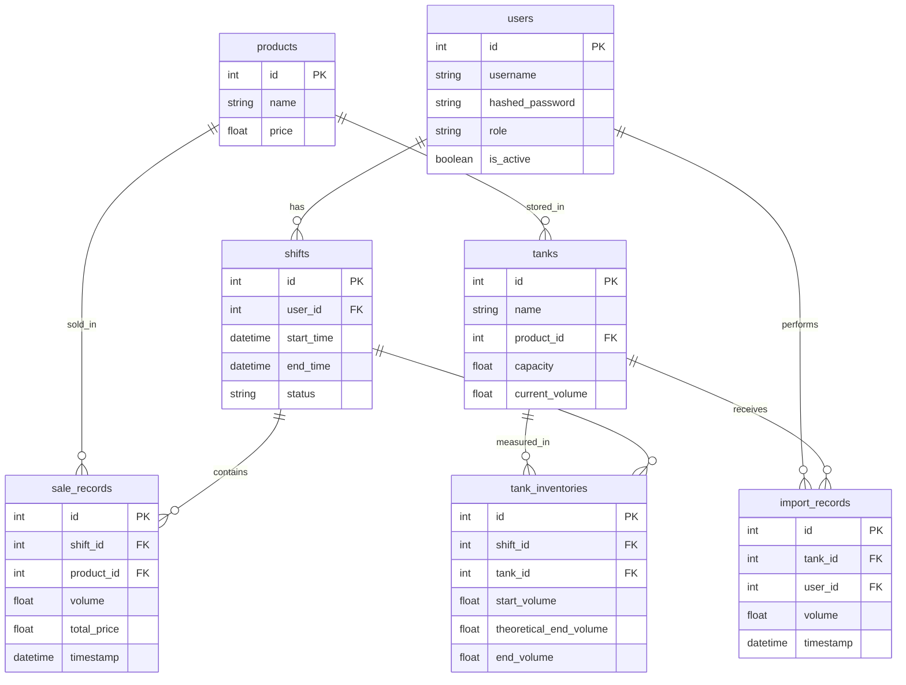

# THIẾT KẾ CƠ SỞ DỮ LIỆU
**Dự án: Hệ thống quản lý trạm xăng dầu tích hợp AI**

---

## 1. Kiến trúc chung (Schema)

Hệ thống sử dụng cơ sở dữ liệu quan hệ với các bảng (Tables) và ràng buộc (Relationships) chính như sau:

### 1.1. Bảng `users` (Người dùng)
- Lưu trữ thông tin tài khoản nhân viên, quản lý.
- **Trường dữ liệu:** `id`, `username`, `hashed_password`, `role` (manager, employee, accountant), `is_active`.

### 1.2. Bảng `products` (Mặt hàng xăng dầu)
- Lưu trữ thông tin về các loại xăng dầu kinh doanh.
- **Trường dữ liệu:** `id`, `name` (VD: RON 95, E5 RON 92, DO), `price`.

### 1.3. Bảng `tanks` (Bồn chứa)
- Quản lý sức chứa và lượng tồn kho thực tế của từng bồn. Liên kết N-1 với bảng `products` (Mỗi bồn chứa 1 loại xăng).
- **Trường dữ liệu:** `id`, `name`, `product_id` (FK), `capacity` (Sức chứa tối đa), `current_volume` (Thể tích hiện tại).

### 1.4. Bảng `shifts` (Ca làm việc)
- Quản lý thời gian trực của nhân viên.
- **Trường dữ liệu:** `id`, `user_id` (FK), `start_time`, `end_time`, `status` (active, closed).

### 1.5. Bảng `sale_records` (Giao dịch bán hàng)
- Lưu trữ mọi giao dịch bơm/bán xăng trong ca làm việc.
- **Trường dữ liệu:** `id`, `shift_id` (FK), `product_id` (FK), `volume` (Số lít bán), `total_price` (Thành tiền), `timestamp`.

### 1.6. Bảng `import_records` (Giao dịch nhập kho)
- Lưu trữ lịch sử các lần xe bồn đến đổ xăng vào trạm.
- **Trường dữ liệu:** `id`, `tank_id` (FK), `user_id` (FK - người thực hiện), `volume`, `timestamp`.

### 1.7. Bảng `tank_inventories` (Chốt tồn kho theo ca)
- Rất quan trọng cho việc phân tích thất thoát. Lưu trữ số liệu tồn kho đầu ca và cuối ca.
- **Trường dữ liệu:** `id`, `shift_id` (FK), `tank_id` (FK), `start_volume` (Tồn đầu), `theoretical_end_volume` (Tồn cuối lý thuyết), `end_volume` (Tồn cuối thực tế).

---

## 2. Sơ đồ thực thể kết hợp (ERD - Entity Relationship Diagram)

Dưới đây là sơ đồ quan hệ của toàn bộ cơ sở dữ liệu hệ thống:

---

## 3. Dữ liệu mẫu minh họa (Sample Data)

Dưới đây là một số dữ liệu giả lập (mock data) để minh họa cách các bảng lưu trữ thông tin thực tế khi hệ thống hoạt động:

### 3.1. Bảng `users`
| id | username | hashed_password | role | is_active |
|:---|:---|:---|:---|:---|
| 1 | admin | $2b$12$e... | manager | True |
| 2 | nhanvien1 | $2b$12$a... | employee | True |
| 3 | ketoan | $2b$12$b... | accountant | True |

### 3.2. Bảng `products`
| id | name | price |
|:---|:---|:---|
| 1 | RON 95-III | 24500.0 |
| 2 | E5 RON 92-II | 23000.0 |
| 3 | Dầu DO 0,05S-II | 21000.0 |

### 3.3. Bảng `tanks`
| id | name | product_id | capacity | current_volume |
|:---|:---|:---|:---|:---|
| 1 | Bồn 1 - RON 95 | 1 | 15000.0 | 9800.5 |
| 2 | Bồn 2 - E5 | 2 | 10000.0 | 4500.0 |
| 3 | Bồn 3 - DO | 3 | 20000.0 | 18200.0 |

### 3.4. Bảng `shifts`
| id | user_id | start_time | end_time | status |
|:---|:---|:---|:---|:---|
| 12 | 2 | 2026-09-30 06:00:00 | 2026-09-30 14:00:00 | closed |
| 13 | 1 | 2026-09-30 14:00:00 | null | active |

### 3.5. Bảng `sale_records`
| id | shift_id | product_id | volume | total_price | timestamp |
|:---|:---|:---|:---|:---|:---|
| 101 | 12 | 1 | 50.0 | 1225000.0 | 2026-09-30 08:15:20 |
| 102 | 12 | 2 | 20.0 | 460000.0 | 2026-09-30 09:30:11 |
| 103 | 12 | 1 | 100.0 | 2450000.0 | 2026-09-30 11:05:45 |

### 3.6. Bảng `tank_inventories` (Dữ liệu phân tích hao hụt)
| id | shift_id | tank_id | start_volume | theoretical_end_volume | end_volume |
|:---|:---|:---|:---|:---|:---|
| 45 | 12 | 1 | 10000.0 | 9850.0 | 9848.5 |
| 46 | 12 | 2 | 4520.0 | 4500.0 | 4500.0 |

*(Lưu ý: Bảng `tank_inventories` trên cho thấy ở ca 12, Bồn 1 thực tế bị hụt 1.5 Lít so với lý thuyết (9850 - 9848.5). Đây chính là điểm dữ liệu để AI đọc và cảnh báo bất thường).*
